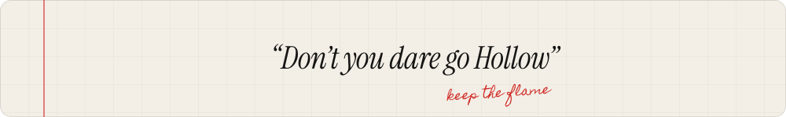

<!-- Généré par scripts/github-profile.mjs depuis le dépôt du portfolio : ne pas modifier à la main. -->

# Alexandre Guedes

**Software Engineering Student** | **Full Stack Developer**

---

## Tech Stack

**Frontend**  

**Backend**  

**Database & Tools**  

---

