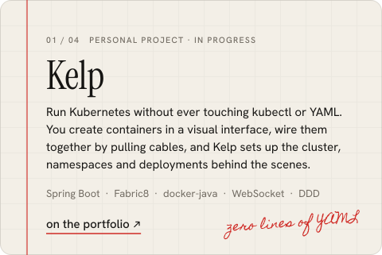
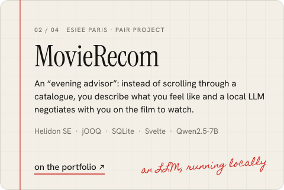
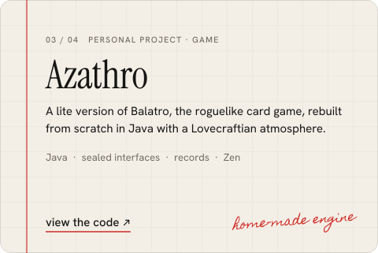
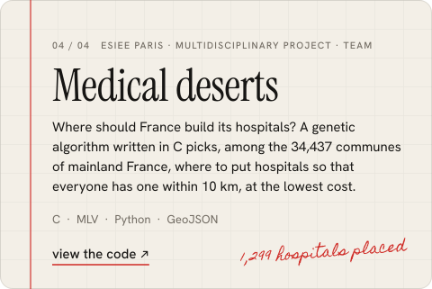
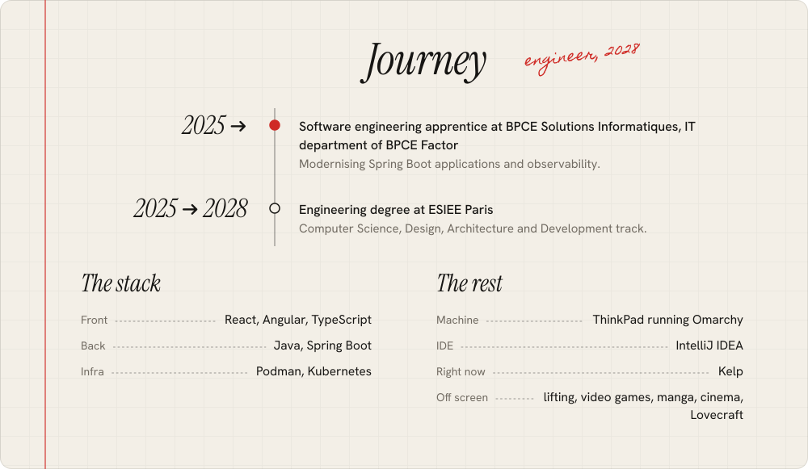

<!-- Généré par scripts/github-profile.mjs depuis le dépôt du portfolio : ne pas modifier à la main. -->

<a href="https://www.alexandreguedes.dev"><b>alexandreguedes.dev</b></a>&nbsp;&nbsp;·&nbsp;&nbsp;<a href="https://www.linkedin.com/in/alexandre-guedesmmi/">LinkedIn</a>&nbsp;&nbsp;·&nbsp;&nbsp;<a href="mailto:alexandreguedes77600@gmail.com">alexandreguedes77600@gmail.com</a>

 

<a href="https://www.alexandreguedes.dev"><b>alexandreguedes.dev</b></a>&nbsp;&nbsp;·&nbsp;&nbsp;<a href="https://www.linkedin.com/in/alexandre-guedesmmi/">LinkedIn</a>&nbsp;&nbsp;·&nbsp;&nbsp;<a href="mailto:alexandreguedes77600@gmail.com">alexandreguedes77600@gmail.com</a>

